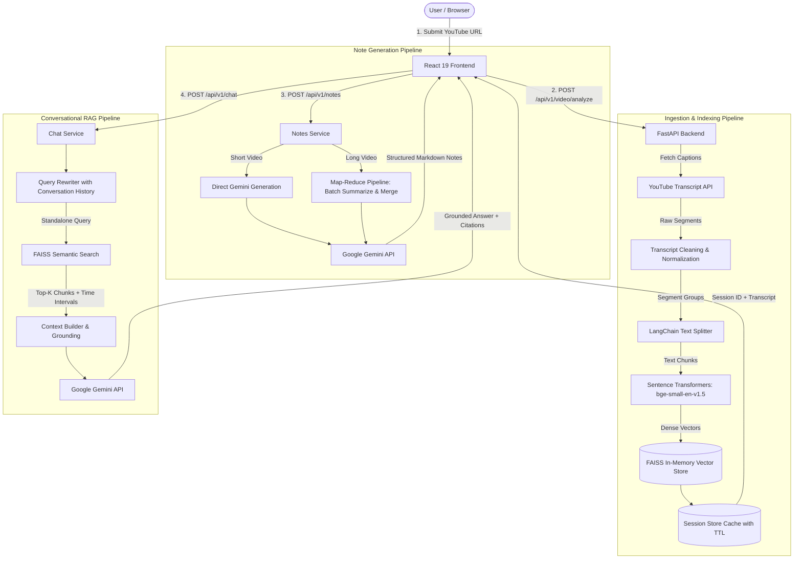

# VidMind 🧠🎥

> **Transform any YouTube video into an interactive, timestamp-synchronized study and research workspace powered by RAG and Google Gemini.**

[](https://fastapi.tiangolo.com)
[](https://react.dev)
[](https://www.python.org)
[](https://ai.google.dev)
[](https://github.com/facebookresearch/faiss)
[](https://tailwindcss.com)

---

## 📌 Problem Statement

YouTube hosts the world's most extensive library of educational lectures, technical workshops, documentation walkthroughs, and conference talks. However, video is an inherently **linear, inefficient, and passive medium** for in-depth learning:

- **Time-Consuming Navigation:** Finding a specific concept, formula, or code snippet in a 1-to-3 hour lecture requires tedious manual scrubbing across the timeline.
- **Cognitive Overload:** Splitting attention between understanding difficult explanations and taking detailed, structured notes often leads to incomplete comprehension.
- **Lack of Interactive Interrogation:** Standard video players do not allow users to ask clarifying questions, test their understanding, or explore sub-topics discussed in the video.
- **Language Barriers & Auto-Caption Inaccuracies:** Foreign-language videos and unformatted auto-generated captions make comprehension and revision unnecessarily exhausting.
- **Hallucinations in Generic AI Summarizers:** Traditional conversational AI tools lack ground-truth transcript access or fail to provide verifiable timestamps, leading to plausible-sounding but false statements without proof.

---

## 💡 The Solution: VidMind

**VidMind** bridges the gap between passive video viewing and active, accelerated learning. By turning any YouTube video URL into a rich, two-way interactive knowledge workspace:

1. **Synchronized Video + Transcript Viewer:** Extracts, cleans, and structures transcripts (supporting multi-language audio with automatic translation to English). Every sentence is mapped to interactive timestamps that seek the embedded video player upon clicking.
2. **Hierarchical AI Study Notes (Map-Reduce):** Automatically creates complete, structured study notes consisting of an executive summary, core concepts, timestamped topic breakdowns, key terms defined in context, examples, and takeaways. For long lectures, an intelligent Map-Reduce pipeline prevents context truncation and hallucination.
3. **Retrieval-Augmented Chat (RAG):** Users can interrogate the video using natural language. VidMind indexes transcript chunks using dense semantic embeddings (`BAAI/bge-small-en-v1.5`) in a high-speed FAISS vector store. Every answer is grounded directly in transcript excerpts, complete with clickable timestamp citations and conversational context rewriting.

---

## ✨ Key Features

- 🎯 **Instant Video Ingestion:** Simply paste any YouTube link (`youtube.com/watch?v=...`, `youtu.be/...`, shorts, or live replays).
- ⏱️ **Clickable Bidirectional Timestamps:** Jump directly to relevant moments in the embedded YouTube player by clicking timestamps in transcripts, AI-generated study notes, or chat citations.
- 💬 **Transcript-Grounded RAG Chat:** Ask questions with follow-ups (e.g., *"Explain the second problem"*, *"What did the speaker say about performance?"*). The system re-writes conversational queries, retrieves top semantic chunks, and answers strictly based on video evidence. If a topic isn't in the video, it clearly tells you.
- 📑 **Comprehensive Structured Notes:**
  - Executive Video Summary
  - Key Concepts List
  - Timestamped Topic Deep Dives `(mm:ss)`
  - Speaker-Defined Terminology
  - Real-world Examples & Case Studies
  - Final Takeaways
  - One-click copy formatted Markdown to clipboard
- 🌐 **Multi-Language & Caption Handling:** Detects manual captions, auto-generated subtitles, and translates foreign-language transcripts to English seamlessly.
- ⚡ **High-Speed In-Memory Vector Search:** FAISS inner-product vector indexing with normalized embeddings ensures instantaneous sub-millisecond retrieval.
- 🔒 **Session & Memory Management:** Built-in session store with TTL (Time-To-Live) expiration and cleanup.
- 🎨 **Modern Cyber-Dark UI:** Built with React 19, Tailwind CSS v4, Lucide aesthetics, responsive dual-pane workspace, and live backend connection heartbeat monitoring.

---

## 🏗️ Architecture & System Design



---

## 🛠️ Tech Stack

### Backend
- **Framework:** FastAPI
- **LLM Engine:** gemini-3.5-flash-lite
- **Embeddings:** sentence-transformers (`BAAI/bge-small-en-v1.5`)
- **Vector Database:** FAISS CPU
- **Text Processing:** `langchain-text-splitters`, `youtube-transcript-api`

### Frontend
- **Framework:** React
- **Styling:** Tailwind CSS
- **Media Integration:** YouTube IFrame Player API

---

## 📂 Repository Structure

```text
VidMind/
├── .gitignore                   
├── README.md                   
├── backend/
│   ├── .env
│   ├── requirements.txt        
│   └── app/
│       ├── main.py              
│       ├── config.py            
│       ├── api/                 
│       │   ├── video.py         
│       │   ├── notes.py         
│       │   ├── chat.py        
│       │   ├── session.py
│       │   └── health.py 
│       ├── models/
│       │   └── schemas.py       
│       ├── services/
│       │   ├── youtube.py       
│       │   ├── transcript.py    
│       │   ├── chunking.py      
│       │   ├── embeddings.py    
│       │   ├── vectorstore.py   
│       │   ├── gemini.py        
│       │   ├── notes.py         
│       │   ├── chat.py          
│       │   └── session_store.py 
│       └── utils/
│           └── video_id.py      
└── frontend/
    ├── .env
    ├── package.json              
    ├── vite.config.ts           
    ├── index.html               
    └── src/
        ├── App.tsx               
        ├── main.tsx              
        ├── index.css            
        ├── pages/
        │   ├── Home.tsx         
        │   └── Workspace.tsx   
        ├── components/
        │   ├── Navbar.tsx   
        │   ├── BackendStatus.tsx
        │   ├── YouTubePlayer.tsx
        │   ├── Transcript.tsx   
        │   ├── AssistantPanel.tsx
        │   ├── Notes.tsx        
        │   ├── Chat.tsx         
        │   ├── ChatMessage.tsx  
        │   └── MarkdownView.tsx 
        ├── services/
        │   ├── api.ts           
        │   └── youtubeApi.ts    
        ├── types/
        │   └── index.ts         
        └── utils/
            └── timestamps.ts    
```

---

## 🚀 Setup & Installation

### Prerequisites

Ensure you have the following installed on your machine:
- **Git:** [Download Git](https://git-scm.com/)
- **Python:** Version 3.11 or higher ([Download Python](https://www.python.org/))
- **Node.js:** Version 18 or higher & npm ([Download Node.js](https://nodejs.org/))
- **Google Gemini API Key:** Obtain a free key from [Google AI Studio](https://aistudio.google.com/)

---

### Step 1: Clone the Repository

Clone the project to your local environment and enter the directory:

```bash
git clone https://github.com/gourxb-28/VidMind.git
cd VidMind
```

---

### Step 2: Backend Setup

1. **Navigate to the backend folder:**
   ```bash
   cd backend
   ```

2. **Create and activate a virtual environment:**
   - **On Windows (PowerShell):**
     ```powershell
     python -m venv .venv
     .venv\Scripts\Activate.ps1
     ```
   - **On macOS / Linux:**
     ```bash
     python3 -m venv .venv
     source .venv/bin/activate
     ```

3. **Install the dependencies:**
   ```bash
   pip install -r requirements.txt
   ```

4. **Configure environment variables:**

   Open `.env` in your editor and provide your Google Gemini API key:
   ```env
   GEMINI_API_KEY=your_actual_gemini_api_key_here
   GEMINI_MODEL=gemini-3.5-flash-lite
   ```

5. **Start the FastAPI server:**
   ```bash
   uvicorn app.main:app --reload --port 8000
   ```
   The backend will be live at `http://127.0.0.1:8000`. You can inspect the interactive Swagger API documentation at `http://127.0.0.1:8000/docs`.

---

### Step 3: Frontend Setup

Open a new terminal window:

1. **Navigate to the frontend folder:**
   ```bash
   cd VidMind/frontend
   ```

2. **Install node dependencies:**
   ```bash
   npm install
   ```

3. **Configure environment variables:**
   ```env
   VITE_API_URL=http://127.0.0.1:8000
   ```

4. **Launch the development server:**
   ```bash
   npm run dev
   ```

5. **Open your browser:**
   Navigate to `http://localhost:5173` to start using VidMind!

---

## ⚙️ Configuration & Environment Variables

### Backend (`backend/.env`)

| Variable | Default Value | Description |
| :--- | :--- | :--- |
| `GEMINI_API_KEY` | *(Required)* | Google Gemini API key from Google AI Studio |
| `GEMINI_MODEL` | `gemini-3.5-flash-lite` | Model name for chat and notes |
| `GEMINI_TIMEOUT_SECONDS` | `60` | HTTP request timeout for Gemini API calls |
| `GEMINI_MAX_ATTEMPTS` | `3` | Maximum retry attempts for transient errors (e.g. rate limits) |
| `GEMINI_RETRY_BASE_SECONDS`| `4.0` | Exponential backoff base wait time |
| `EMBEDDING_MODEL` | `BAAI/bge-small-en-v1.5` | Hugging Face model used for dense semantic retrieval |
| `CHUNK_SIZE` | `1000` | Target character size per transcript chunk |
| `CHUNK_OVERLAP` | `200` | Character overlap between consecutive chunks |
| `TOP_K` | `8` | Number of relevant chunks retrieved per user question |
| `ALLOWED_ORIGINS` | `http://localhost:5173` | Allowed CORS origins (comma-separated) |
| `SESSION_TTL_MINUTES` | `120` | In-memory session lifespan in minutes |
| `MAX_SESSIONS` | `100` | Maximum concurrent active sessions retained in memory |
| `MAX_TRANSCRIPT_CHARS`| `300000` | Transcript length cap to safeguard server memory |
| `NOTES_DIRECT_CHAR_LIMIT`| `30000` | Threshold character count above which Map-Reduce is triggered |
| `NOTES_BATCH_CHARS` | `12000` | Batch character size for Map-Reduce note summarization |

### Frontend (`frontend/.env`)

| Variable | Default Value | Description |
| :--- | :--- | :--- |
| `VITE_API_URL` | `http://127.0.0.1:8000` | URL where the FastAPI backend server is reachable |

---

## 🔌 API Endpoints Reference

All video, notes, and chat operations use the `/api/v1` prefix:

### 1. `GET /health`
- **Description:** Health check used by the frontend connectivity badge.
- **Response:** `{"status": "ok"}`

### 2. `POST /api/v1/video/analyze`
- **Description:** Ingests a YouTube URL, fetches transcripts, builds embeddings & FAISS index, and creates a session.
- **Request Body:**
  ```json
  {
    "url": "https://www.youtube.com/watch?v=dQw4w9WgXcQ"
  }
  ```
- **Response:** Returns `session_id`, `video_id`, detected language, caption metadata, and grouped transcript segments.

### 3. `POST /api/v1/notes`
- **Description:** Generates structured Markdown notes for the session (uses caching if already created).
- **Request Body:**
  ```json
  {
    "session_id": "8fa2163b-0e4f-4d92-9382-bc1025a7d901"
  }
  ```
- **Response:** `{"notes": "# Summary\n..."}`

### 4. `POST /api/v1/chat`
- **Description:** Asks a question using conversational RAG grounded in the video transcript.
- **Request Body:**
  ```json
  {
    "session_id": "8fa2163b-0e4f-4d92-9382-bc1025a7d901",
    "question": "What is the main algorithm used?",
    "history": [
      { "role": "user", "text": "Who is the speaker?" },
      { "role": "assistant", "text": "The speaker is Dr. Smith." }
    ]
  }
  ```
- **Response:**
  ```json
  {
    "answer": "The speaker explains Dijkstra's algorithm around 04:15...",
    "sources": [
      {
        "start_time": 255.0,
        "end_time": 310.0,
        "timestamp": "04:15",
        "text": "Now we move to Dijkstra's algorithm for finding shortest paths..."
      }
    ]
  }
  ```

### 5. `DELETE /api/v1/session/{session_id}`
- **Description:** Explicitly clears and frees memory allocated to a session's FAISS index and transcripts.

---

## 🛡️ Security & Privacy Notice

- **API Keys & Secrets:** Never commit your `.env` files. Both `backend/.env` and `frontend/.env` are ignored by `.gitignore`.
- **Local Vectors:** Video transcripts and embeddings are indexed locally in-memory using FAISS and are never stored in third-party hosted vector databases.
- **Data Minimization:** Only relevant transcript chunks are provided to the LLM during question answering, minimizing token usage and latency.

